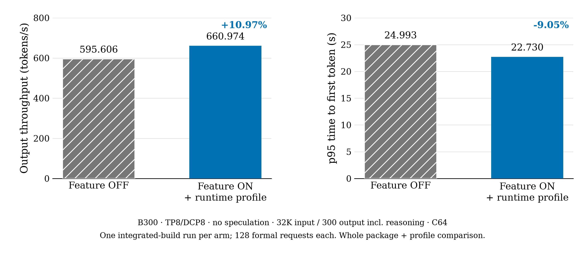

# Kimi K3 TP8 decode with DCP and HiCache

Two explicit profiles extend the existing Kimi K3 executor from [#17](https://github.com/sgl-project/sgl-nvidia-mega/pull/17).
Both require the companion SGLang native-MLA/restore binding and
`--enable-nvidia-megakernel`; installing the package alone does not select them.

| Profile | Attention core | Additional prepared providers |
| --- | --- | --- |
| `k3_native_mla` | SGLang MLA and native DCP gather/LSE merge | Existing projection, KDA, MoE and AttnRes |
| `k3_full_decode` | Fused MLA/query/value and DCP mailbox | TP embedding, B1/B2 tiny GEMM and B1–8 L2 weight prefetch |

Select exactly one profile with `SGLANG_NVIDIA_MEGAKERNEL_SLOTS`. For the full
profile, install the pinned MLA dependencies before starting SGLang:

```sh
pip install -e '.[k3-full-decode]'
export SGLANG_NVIDIA_MEGAKERNEL_SLOTS=k3_full_decode
```

The optional extra pins `tokenspeed-mla==2.0.3` and `apache-tvm-ffi==0.1.11`.
SGLang's CUDA environment must also supply the existing torch, FlashInfer,
CuTe DSL and CUDA Python dependencies. Startup checks the private dependency
signatures before constructing resources or capturing graphs.

## Admitted configuration and ownership

The profiles admit single-node SM103 TP8, DCP1 or DCP8, BF16 activations,
packed-MXFP4 experts, FP8 E4M3 KV, page size 64 and full decode graphs. Devices
need at least 148 SMs and must pass the compiled-kernel residency checks.
Preparation merges the default widths 1–8, 16, 32, 48 and 64 with configured
request buckets up to 64. SGLang passes an immutable copy of those request buckets
before KV sizing; this NOSPEC profile consumes each bucket once. A configured
24- or 37-request graph can therefore use the complete specialized chain.
Widths above 64, prefill, embedding-only calls and pipeline proxy calls retain
the original model forward. Eager execution, profiling and warmup also use the
original model; only full decode graph capture selects the specialized chain.

A later request-pool clamp can synthesize a bucket not prepared before KV sizing.
That bucket remains native; no new provider or persistent workspace is allocated
at replay. The existing framework still refuses an enabled runner if none of its
captured buckets uses the specialized path. Additional prepared shapes consume
resources, so earlier image capacity measurements do not qualify a new shape set.

The configured context may be up to 1,048,576 tokens, also bounded by the native
model limit. Admission is not evidence that the entire context range is tested.
HiCache is the admitted offload path. Other offload systems, PP/EP, LoRA,
prefill CP, unified/page-major KV, TP16, SM100 and multi-node execution are outside
this extension. DSpark stays in the separate [#25](https://github.com/sgl-project/sgl-nvidia-mega/pull/25) work.

SGLang retains KV pages, KDA persistent state, request lifetimes and cache policy.
The binding exposes owner-local KV writes, global versus local sequence lengths,
native attention calls and live restore joins. Captured storage replacement is
refused. Native replicated-Q buffers remain available to the stock path; the
specialized providers validate the original twelve-head weight shards.

The full profile reserves MLA workspaces before KV sizing, bounds remote polling,
checks DCP mailbox topology and uses a one-wave DCP B2 query tile. Initialization
synchronizes local GPU writes before a Gloo barrier with the same ordered members
as the device group, avoiding initialization of unused device collectives.

## Source and validation scope

The existing executor and kernel payload remain SGLang/NVIDIA community work.
The comparison source is [vLLM #61867](https://github.com/vllm-project/vllm/pull/61867)
at `063c0c6d25658ed0702670b2fd07f02f21cadf10`; L2 prefetch orchestration is adapted
from its runtime. Apache notices and file-level attribution are retained.
B1/B2 projections reuse SGLang's `tiny_gemm`; they do not copy vLLM's skinny
GEMM or establish identical scheduling, numerics or speed. The extended profiles
now use non-cooperative expert launch to retain PDL overlap, matching the reference
policy. The launch choice is part of the compiled-code cache key; actual compiled
residency checks remain required. The default community profile stays cooperative.
No speedup is claimed for this source-only scheduling change.

Earlier validation of the source feature used B300 SM103 TP8/DCP8, NOSPEC,
the full 93 layers and a separately pinned image plus memory/inference profile.
It covered Host/Store restore with same-engine exact-zero selected-logprob deltas,
bounded edge requests and cross-engine selected-logprob deltas up to 0.298598
(bound 0.5). Protocol coverage was limited to PDF Chat SSE, stored Responses
GET/continuation and cancellation of an already completed response. Graph64
evidence establishes a host-launch lower bound, not a GPU-completion counter.

For 128 formal requests after three warmups, 32,768 input tokens, 300 output
tokens including reasoning and concurrency 64, the recorded output rate was
595.606 → 660.974 token/s and p95 TTFT was 24.993 → 22.730 s. This is a whole
feature plus memory/inference-profile observation (`pure_kernel_AB=false`), not
an individual-kernel result or a reproduction of vLLM's measurements. The original
120-second after-peer metadata deadline failed; an authorized late metadata-only
continuation completed the remaining checks with zero generation POSTs. The
original failure is retained, so this is not an original strict-comparator pass.



One integrated-build run per arm; all formal requests hit the 300-token output
cap. The figure compares the source/image and memory/inference profile together,
with no estimate of run-to-run variance. It does not measure the current PR heads.
[Aggregate data](assets/kimi-k3-tp8/measurements.json), the
[plot script](assets/kimi-k3-tp8/plot_measurements.py) and a
[vector PDF](assets/kimi-k3-tp8/integrated-comparison.pdf) are included.

Those results do not GPU-qualify the extracted upstream branches. Configured
bucket preparation, native warmup routing and expert launch policy changed after
that run. Its effective 133-request capacity is not a capacity promise for this
source pair. CUDA compilation, full-model correctness, task quality and net
performance need fresh validation. No full 1M-input test, all-workload equivalence, active-cancel/delete/
expiry coverage or DSpark qualification is claimed.

## CPU CI dependency

K3 CPU CI uses the exact companion SGLang revision recorded in
`.github/workflows/unit-test.yml`. Other models retain their existing SGLang pin
and mirror checks; this feature does not update their runtime adaptations. The
shared binding callable checks run with the K3 companion. Once it is merged,
replace that fork pin with the merged upstream revision before removing the split.
The runtime source delta remains opt-in and the older default profile is retained.
